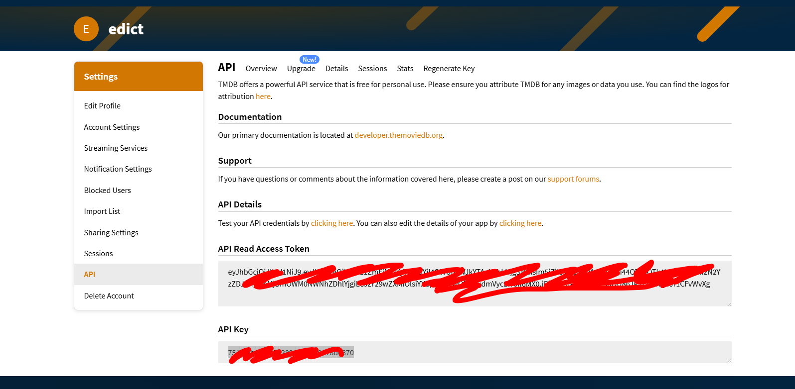
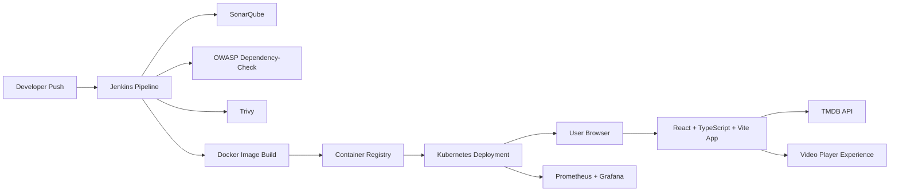
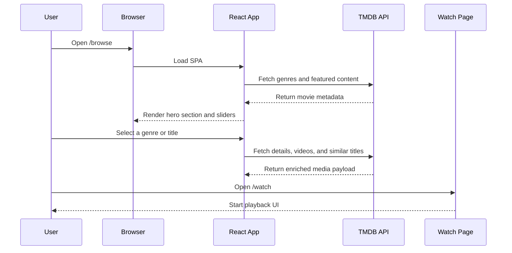
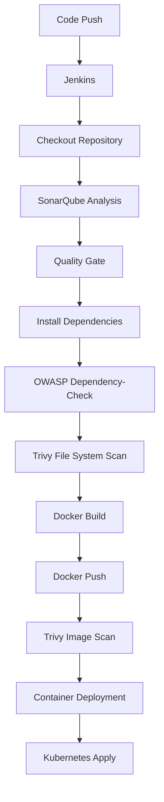

<div align="center">

# Netflix Clone DevSecOps

[](https://react.dev/)
[](https://www.typescriptlang.org/)
[](https://vitejs.dev/)
[](https://www.docker.com/)
[](https://www.jenkins.io/)
[](https://kubernetes.io/)
[](#license)

A production-style **Netflix-inspired streaming UI** built with **React, TypeScript, Vite, Material UI, and TMDB**, packaged with **Docker** and supported by a **DevSecOps workflow** featuring **Jenkins, SonarQube, Trivy, OWASP Dependency-Check, Kubernetes, Prometheus, and Grafana**.

</div>

---

## Table of Contents

- [About the Project](#about-the-project)
- [Getting Started](#getting-started)
- [Usage](#usage)
- [Architecture / Data Flow](#architecture--data-flow)
- [Testing](#testing)
- [Deployment / Infrastructure](#deployment--infrastructure)
- [Roadmap \& Future Scope](#roadmap--future-scope)
- [Contributing](#contributing)
- [License](#license)
- [Notes](#notes)

## About the Project

This project combines two goals:

1. Build a polished frontend that mimics the Netflix browsing experience.
2. Demonstrate how a frontend application can be shipped through a practical DevSecOps pipeline.

The application uses **The Movie Database (TMDB)** as its content source. Users can browse featured titles, explore genres, open detail modals, and access a dedicated watch experience. Around that app, the repository includes infrastructure assets for containerization, Jenkins-driven CI/CD, security scanning, Kubernetes deployment, and monitoring setup guidance.

### Highlights

- Browse a Netflix-style home page with hero content and slider rows
- Explore content by popular categories and TMDB genres
- Open media details with appended video metadata
- Watch content through a dedicated player page
- Build and serve the app through Docker + NGINX
- Run static analysis and security scans in Jenkins
- Deploy to Kubernetes using provided manifests
- Extend observability with Prometheus and Grafana

### Screenshot



### Architecture Overview



### Tech Stack

| Layer | Tools |
|---|---|
| Frontend | React 18, TypeScript, Vite |
| UI | Material UI, Emotion, Framer Motion |
| State Management | Redux Toolkit, RTK Query |
| Routing | React Router |
| Media | video.js, videojs-youtube |
| API | TMDB v3 API |
| Containerization | Docker, NGINX |
| CI/CD | Jenkins |
| Security | SonarQube, Trivy, OWASP Dependency-Check |
| Orchestration | Kubernetes |
| Monitoring | Prometheus, Grafana |
| Hosting Support | Vercel rewrite config included |

### Project Structure

<details>
<summary>Expand repository layout</summary>

```text
.
├── Dockerfile
├── Kubernetes/
│   ├── deployment.yml
│   ├── node-service.yaml
│   └── service.yml
├── public/
│   └── assets/
├── src/
│   ├── components/
│   ├── hooks/
│   ├── layouts/
│   ├── pages/
│   ├── providers/
│   ├── routes/
│   ├── store/
│   ├── theme/
│   ├── types/
│   └── utils/
├── package.json
├── pipeline.txt
├── tsconfig.json
├── vercel.json
└── vite.config.ts
```

</details>

## Getting Started

### Prerequisites

Install the following before running the project:

- Node.js 16+ 
- Yarn Classic or npm
- Docker
- A TMDB API key
- Jenkins, SonarQube, and Trivy for the full DevSecOps workflow
- A Kubernetes cluster if you want to use the manifests

### Environment Variables

Create your environment values before running the app locally or building the container.

| Variable | Required | Description | Safe Example |
|---|---|---|---|
| `VITE_APP_TMDB_V3_API_KEY` | Yes | TMDB v3 API key used by the frontend | `your_tmdb_key_here` |
| `VITE_APP_API_ENDPOINT_URL` | Yes | Base URL for the TMDB API | `https://api.themoviedb.org/3` |
| `TMDB_V3_API_KEY` | For Docker build | Build argument consumed by the Dockerfile and mapped into the Vite env variable | `your_tmdb_key_here` |

### Local Installation

1. Clone the repository.

```bash
git clone https://github.com/surya-edict/Netflix-Clone-DevOps.git
cd Netflix-Clone-DevOps
```

2. Install dependencies.

```bash
yarn install
```

3. Start the development server.

```bash
yarn dev
```

4. Build for production.

```bash
yarn build
```

### Docker Setup

Build the production image with your TMDB key:

```bash
docker build --build-arg TMDB_V3_API_KEY=your_tmdb_key_here -t netflix-clone-devsecops .
```

Run the container locally:

```bash
docker run -d --name netflix-clone -p 8081:80 netflix-clone-devsecops
```

Open the app at:

```text
http://localhost:8081
```

## Usage

### Example 1: Run locally for development

```bash
yarn install
yarn dev
```

Once the app starts, open the local Vite URL in your browser and browse:

- `/browse` for the main landing experience
- `/genre/:genreId` for a category-specific grid view
- `/watch` for the player page

### Example 2: Run the production container

```bash
docker build --build-arg TMDB_V3_API_KEY=your_tmdb_key_here -t netflix-clone-devsecops .
docker run -d --name netflix-clone -p 8081:80 netflix-clone-devsecops
```

<details>
<summary>Expected container behavior</summary>

```text
- The React application is built in a Node.js builder stage
- Static assets are copied into an NGINX image
- NGINX serves the built frontend on port 80
```

</details>

## Architecture / Data Flow

### Application Flow



### CI/CD and Deployment Flow



### Infrastructure Components

- **Frontend app** renders a streaming-style SPA using Vite and React
- **TMDB API** provides movie metadata, categories, and appended videos
- **Dockerfile** creates a multi-stage image and serves the app via NGINX
- **Jenkins pipeline** orchestrates CI, security checks, build, and deployment
- **Kubernetes manifests** define deployment and service exposure
- **Monitoring layer** is documented for Prometheus and Grafana integration

## Testing

This repository currently exposes a **build verification workflow** rather than a dedicated automated unit test suite.

### Run the available validation command

```bash
yarn build
```

### Security and quality validation in Jenkins

The pipeline includes these checks:

- SonarQube static analysis
- Quality gate enforcement
- OWASP Dependency-Check
- Trivy filesystem scan
- Trivy container image scan

### Recommended next step

Add one or more of the following to raise engineering maturity:

- Unit tests for reusable React components
- Integration tests for routing and API state flows
- End-to-end tests for browse, genre, and watch journeys

## Deployment / Infrastructure

### Docker

The repository ships with a multi-stage [Dockerfile](file:///d:/INTERN/DEVOPS/Netflix/Dockerfile) that:

- Installs dependencies
- Injects the TMDB API key at build time
- Builds the Vite application
- Serves the output with NGINX

Deploy locally:

```bash
docker build --build-arg TMDB_V3_API_KEY=your_tmdb_key_here -t netflix-clone-devsecops .
docker run -d --name netflix-clone -p 8081:80 netflix-clone-devsecops
```

### Kubernetes

The repository includes:

- [deployment.yml](file:///d:/INTERN/DEVOPS/Netflix/Kubernetes/deployment.yml)
- [service.yml](file:///d:/INTERN/DEVOPS/Netflix/Kubernetes/service.yml)
- [node-service.yaml](file:///d:/INTERN/DEVOPS/Netflix/Kubernetes/node-service.yaml)

Apply the manifests:

```bash
kubectl apply -f Kubernetes/deployment.yml
kubectl apply -f Kubernetes/service.yml
```

### Jenkins Pipeline

The pipeline definition lives in [pipeline.txt](file:///d:/INTERN/DEVOPS/Netflix/pipeline.txt) and demonstrates:

- Source checkout
- SonarQube integration
- Quality gate checks
- Dependency scanning
- Trivy scans
- Docker build and push
- Container deployment
- Kubernetes deployment stage
- Email notification hooks

### Monitoring

The repository documentation also outlines:

- Prometheus installation
- Node Exporter setup
- Jenkins metrics scraping
- Grafana integration

## Roadmap & Future Scope

- [ ] Add `.env.example` for faster onboarding
- [ ] Add automated unit and integration tests
- [ ] Replace placeholder Docker registry/image references with project-specific values
- [ ] Parameterize Jenkins credentials and deployment targets
- [ ] Add Helm charts or Kustomize overlays
- [ ] Add GitHub Actions as an alternative CI workflow
- [ ] Add dashboards and alert rules for production monitoring
- [ ] Improve the watch page with real media metadata and playback sources

## Contributing

Contributions are welcome.

1. Fork the repository
2. Create a feature branch
3. Make your changes
4. Verify the build locally
5. Open a pull request with a clear description

Suggested workflow:

```bash
git checkout -b feature/your-change
yarn install
yarn build
git commit -m "Describe your change"
git push origin feature/your-change
```

## License

This README documents the project as **MIT licensed by default** unless you intend to use another license.

## Notes

- A TMDB API key is required for the app to function correctly
- The pipeline and Kubernetes files currently contain sample repository, image, credential, email, and cluster placeholders that should be updated before production use
- Vercel routing support is present through [vercel.json](file:///d:/INTERN/DEVOPS/Netflix/vercel.json)

> Missing project details to fill in: actual production URL, final Docker image name, real Jenkins credential IDs, Kubernetes cluster/server details, notification email, and an explicit `LICENSE` file if the intended license is not MIT.
